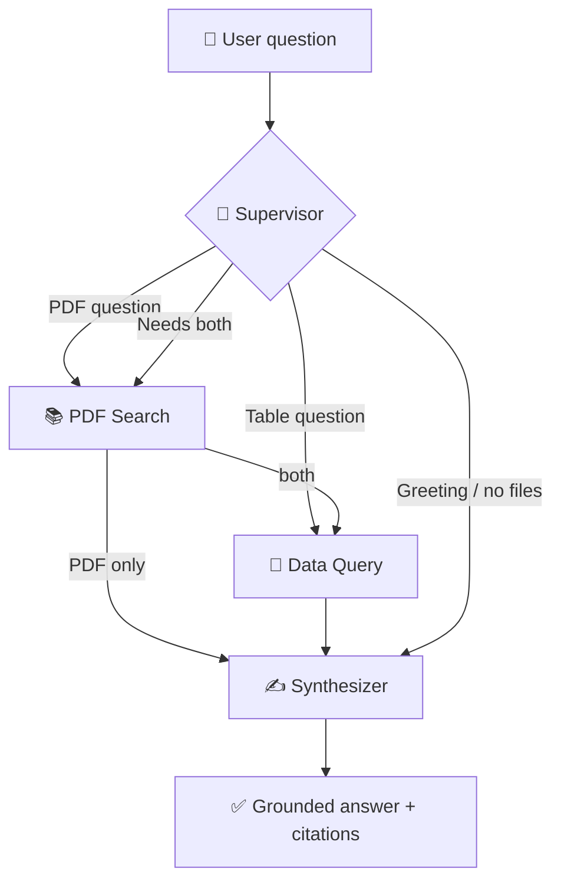

<div align="center">

# 🧠⚡ MULTI-DOCUMENT AI AGENT ⚡🧠

### Drop in PDFs, CSVs and Excel files. Ask anything. The agent decides where to look.


**Built by [Yash Bhure](https://github.com/yashbhure009)**

</div>

---

## 🚀 What is this?

**Multi-Document AI Agent** is a Streamlit chatbot built on **LangGraph + LangChain**. You upload **any number of PDFs, CSV files and Excel workbooks** at runtime, and a supervisor agent reads a catalog of everything you uploaded, picks the right files for each question, and answers **only from your files**.

No pre-loaded database. No hard-coded PDF. Your files are the single source of truth.

> Ask about a PDF → it searches the PDF.
> Ask about a table → it writes and runs pandas code.
> Ask something that needs both → it uses both and combines the evidence.

---

## ✨ Features

- 📂 **Multi-file upload**: many PDFs, `.csv`, `.xlsx`, `.xlsm` and `.xls` files at once
- 🧭 **Smart supervisor routing**: chooses PDF search, data query, both, or neither, per question
- 💬 **Follow-up aware**: rewrites questions like "and in Mumbai?" into standalone queries using recent chat history
- 📚 **PDF RAG with page citations**: each PDF is indexed with page metadata and searched per file, so every selected file is represented
- 🐼 **Cross-file pandas**: generated code can read several tables at once through `dfs["file.csv"]` and `dfs["book.xlsx::Sheet1"]`, so merges across files work
- 📑 **Every Excel sheet becomes its own table**
- 🔁 **Self-correcting code generation**: failed pandas code is retried up to 3 times with the error fed back
- 🛡️ **Restricted execution**: blocked imports, file access, dunder tricks and write methods before any generated code runs
- 🎯 **Grounded answers**: facts come only from retrieved excerpts and computed results; missing info is reported as "not found", never guessed
- 🔍 **"How this was answered" panel**: shows the route, files used, generated code, result table and PDF sources
- 🔐 **API key via `.env`**, never in the code

---

## 🧩 Architecture



| Node | Job |
|---|---|
| **Supervisor** | Reads the file catalog and chat history, rewrites the question, selects PDFs and tables |
| **PDF Search** | Vector search in ChromaDB, filtered per selected PDF |
| **Data Query** | LLM writes pandas code, it is validated, executed, and retried on error |
| **Synthesizer** | Writes the final answer strictly from the gathered evidence |

---

## 📁 Project structure

```text
multi-document-ai-agent/
├── chatbot.py            # Streamlit UI: uploader, chat, trace panel
├── agent.py              # LangGraph agent: supervisor → search / query → answer
├── store.py              # Per-session file store: PDF vector index + DataFrames
├── safe_exec.py          # Validation and restricted execution of generated code
├── requirements.txt      # Python dependencies
├── .env.example          # Template for your API key
├── .gitignore
├── README.md
├── sample_data/          # Try-me files
│   ├── employee_db.csv
│   ├── emp1.csv
│   └── BMW_Z4_Complete_Guide_India.pdf
├── notebooks/            # Learning notebooks
│   ├── RAG_PIPELINE.ipynb
│   ├── query_generator.ipynb
│   └── multi_agent.ipynb
└── experiments/          # Early standalone apps
    ├── RAG_PDF_APP.py
    ├── Query_Gen_APP.py
    └── notes_maker.py
```

---

## ⚙️ Installation

### 1. Clone

```bash
git clone https://github.com/yashbhure009/multi-document-ai-agent.git
cd multi-document-ai-agent
```

> 📌 **Stay in this folder for every command below.** It is the project root, the one that contains `chatbot.py` and `requirements.txt`. If you downloaded the files manually instead of cloning, put `requirements.txt` here, next to `chatbot.py`, not inside a subfolder.

### 2. Virtual environment

Windows:

```bat
python -m venv venv
venv\Scripts\activate
```

macOS / Linux:

```bash
python3 -m venv venv
source venv/bin/activate
```

### 3. Install dependencies

```bash
python -m pip install --upgrade pip
python -m pip install -r requirements.txt
```

If pip says `Could not open requirements file`, you are in the wrong folder. Run `cd` into the project root and try again.

### 4. Add your Groq API key

Copy `.env.example` to `.env` and fill it in:

```env
GROQ_API_KEY=your_groq_api_key_here
```

> Never commit `.env` or share your key.

### 5. Run

```bash
streamlit run chatbot.py
```

Open `http://localhost:8501`. On the first run, ChromaDB may download its small embedding model, so allow a minute.

---

## 🧪 How to use

1. Upload files in the sidebar (PDFs, CSVs, Excel).
2. Wait for the file list to show your PDFs and tables.
3. Ask a question in the chat box.
4. Read the answer, then open **How this was answered** to see the route, code and sources.

### Example questions

```text
What does the BMW guide say about the M40i's 0-100 km/h time?        → PDF
How many employees are in each city?                                  → Table
Top 3 employees per department by 60% PerformanceScore + 40% Projects → Table
Which employees live in the city mentioned in the PDF?                → Both
And what about Mumbai?                                                → Follow-up
```

---

## 🧠 How accuracy is enforced

- Answers use **only** retrieved PDF excerpts and executed table results
- Numbers, names, currencies and units are copied exactly, never recomputed or rounded
- Document facts are cited as `(file, p.N)`; table results name the table used
- If something is missing, the agent says which part is **not found in the uploaded files**
- If the generated code fails after 3 attempts, the error is shown instead of a guess
- Text filters are case-insensitive, and low-cardinality columns expose their real values to the code generator

---

## 🛡️ Security note

Generated code runs through a **regex blocklist** and a restricted set of builtins. That is fine for local and learning use, but it is **not a full sandbox**. Before exposing this app to untrusted users, run generated code in a separate process or container with a timeout.

---

## 🧯 Troubleshooting

| Problem | Fix |
|---|---|
| `GROQ_API_KEY is missing` | Create `.env` next to `chatbot.py` with your key |
| `ModuleNotFoundError` | Activate the virtual environment, then rerun `pip install -r requirements.txt` |
| PDF rejected: "No extractable text" | It is a scanned PDF. Run OCR on it first |
| PDF rejected: "password-protected" | Remove the password and re-upload |
| `.xls` file fails to load | Make sure `xlrd` is installed |
| App shows stale behavior | Stop Streamlit with `Ctrl+C` and start it again |
| Pandas `FutureWarning` in the terminal | Comes from LLM-generated code (for example `groupby.apply`). It is harmless |
| Files vanish after refresh | Expected: indexes live in memory per browser session |

---

## 🗺️ Roadmap

- [ ] OCR support for scanned PDFs
- [ ] Persistent vector index across sessions
- [ ] Sandboxed code execution in a subprocess with timeout
- [ ] Charts for table results
- [ ] Conversation export
- [ ] Word (`.docx`) and text file support
- [ ] Authentication and user-specific workspaces
- [ ] Deploy to Streamlit Community Cloud

---

## 🧰 Tech stack

| Layer | Tools |
|---|---|
| UI | Streamlit |
| Agent orchestration | LangGraph |
| LLM interface | LangChain, `langchain-groq` (`openai/gpt-oss-120b`) |
| Vector search | ChromaDB |
| PDF parsing | pypdf |
| Data analysis | pandas, numpy, openpyxl, xlrd |
| Schemas and config | pydantic, python-dotenv |

---

## 👨‍💻 Author

**Yash Bhure**
Computer Engineering student, cybersecurity and AI enthusiast.

- GitHub: [github.com/yashbhure009](https://github.com/yashbhure009)
- LinkedIn: [linkedin.com/in/yashbhure](https://linkedin.com/in/yashbhure)

If this project helped you, drop a ⭐ on the repo!

---

## 📄 License

Released under the MIT License. Add a `LICENSE` file with the MIT text before publishing.